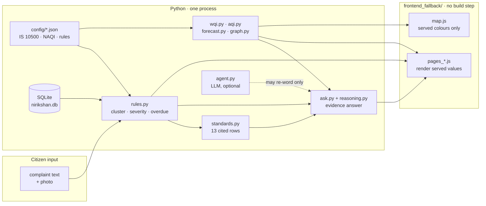
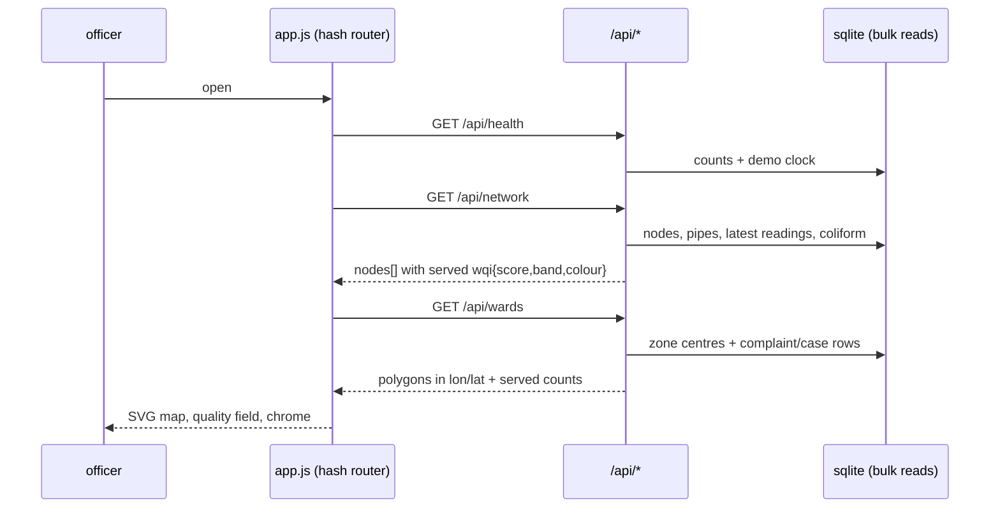
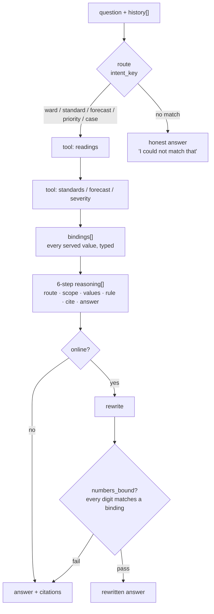
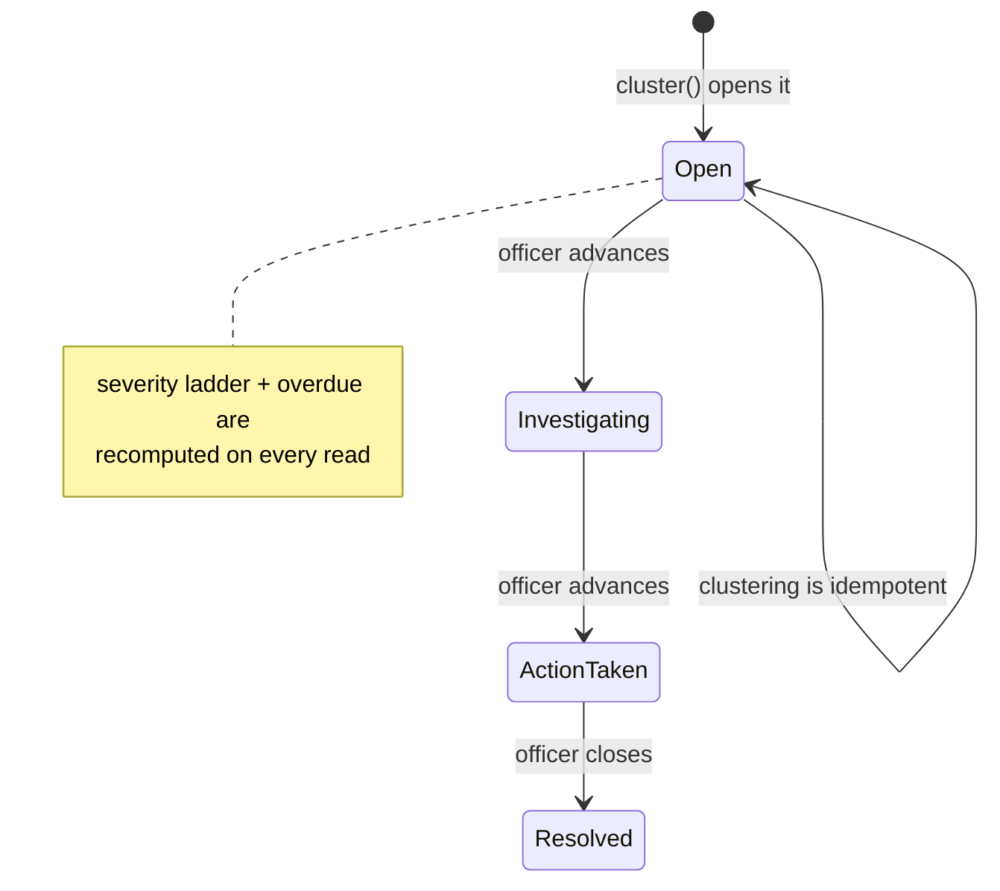

# Nirikshan — system map

Five diagrams, one page. Every one describes code that exists in this repo; none is
aspirational. Read this with `README.md` for the demo script and `PROGRESS.md` for the
build log.

---

## 1. Where the truth lives

The single rule the whole product obeys: **the browser renders, the server decides.**
No threshold, band, severity, clock or verdict is computed in JavaScript.

`agent.py` is drawn dotted on purpose: with no key it is not called at all, and when a
key exists it may only rewrite prose whose numbers are already bound to evidence.

---

## 2. Request path, cold load to rendered page

One bulk read per screen. No N+1: `graph.load_graph` and `rules.bulk_latest` exist for
exactly this reason.

---

## 3. The AI loop (what changed)

Before: keyword router → template → optional re-word. The model never reasoned, and
"grounding" was a substring test against a JSON blob.

Now:

The trace is a record, not a monologue: each step carries the module that did the work
(`db.readings`, `forecast.chlorine`, `rules.severity`) and its own citations. A model
can add prose; it cannot add a step, a number or a citation.

---

## 4. Case lifecycle

Only the next status in the server's whitelist is ever accepted; an illegal transition
answers 400 with the allowed list.

---

## 5. Route map

| Route | Page | Reads |
|---|---|---|
| `#/welcome` | role picker (demo flag only) | — |
| `#/` | city overview, ward zones | overview, network, wards, air, cases, complaints |
| `#/map` | network map, trace, quality field | network, cases, wards, node detail |
| `#/complaints` | intake + tracker | complaints, nodes |
| `#/cases` | case list | cases |
| `#/cases/<id>` | evidence, trace, draft, history | case, standards |
| `#/nodes/<id>` | sensor detail, forecast | node, readings, forecast |
| `#/air` | monitors, 24 h projection | air, air readings |
| `#/land` | photo reports, proximity | land reports, land meta |
| `#/reports` | daily DRAFT summary | reports/daily, health |
| `#/ask` | evidence assistant + reasoning | ask |

---

## 6. Interfaces added by this pass

| Endpoint | Returns | Why |
|---|---|---|
| `GET /api/wards` | Voronoi polygons in lon/lat + served WQI, complaints, open cases | zones are derived from ward centres, not hand-drawn |
| `GET /api/map-config` | `{provider, key, libraries}` | Google basemap is opt-in; schematic is the default |
| `POST /api/ask` | `answer, citations, reasoning[6], bindings[], evidence, followups[], elapsed_ms` | the reasoning is now visible and auditable |

`/api/ask` also accepts `history[]`, so "and Ward 4?" inherits the previous scope — the
scope only. Every number is re-read from the engine.
